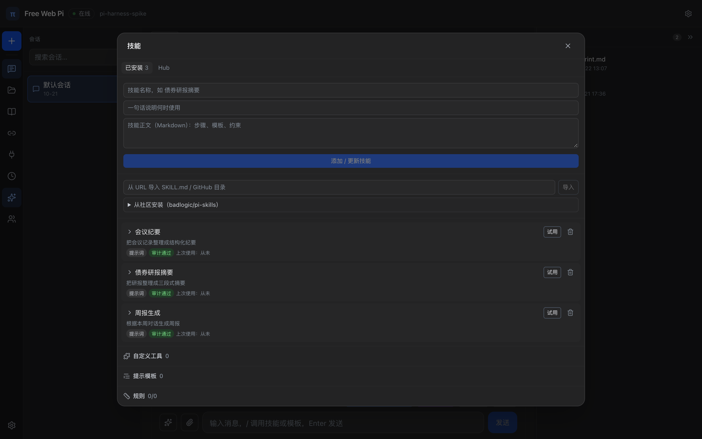
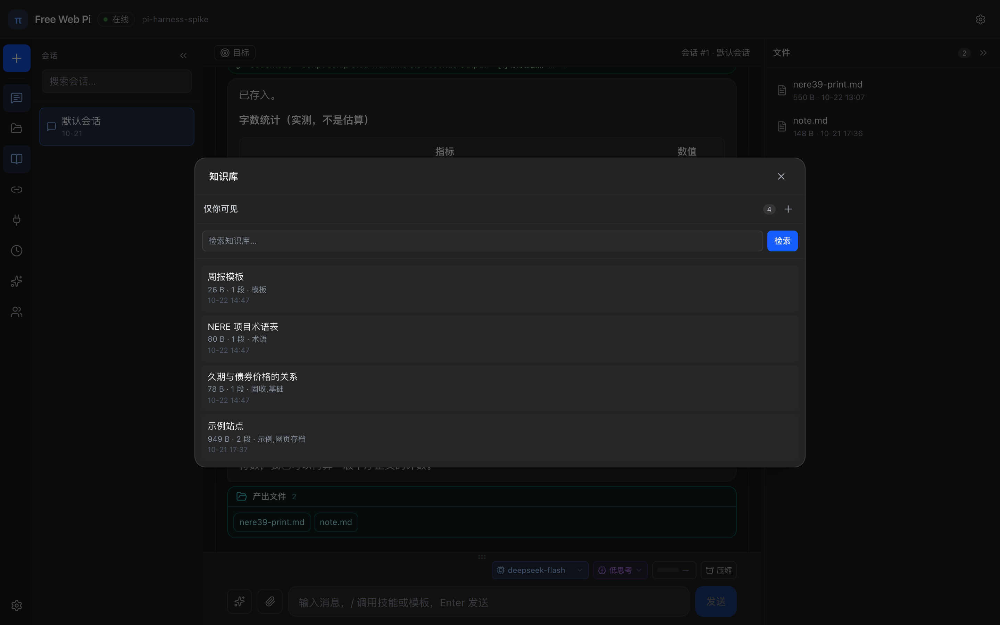
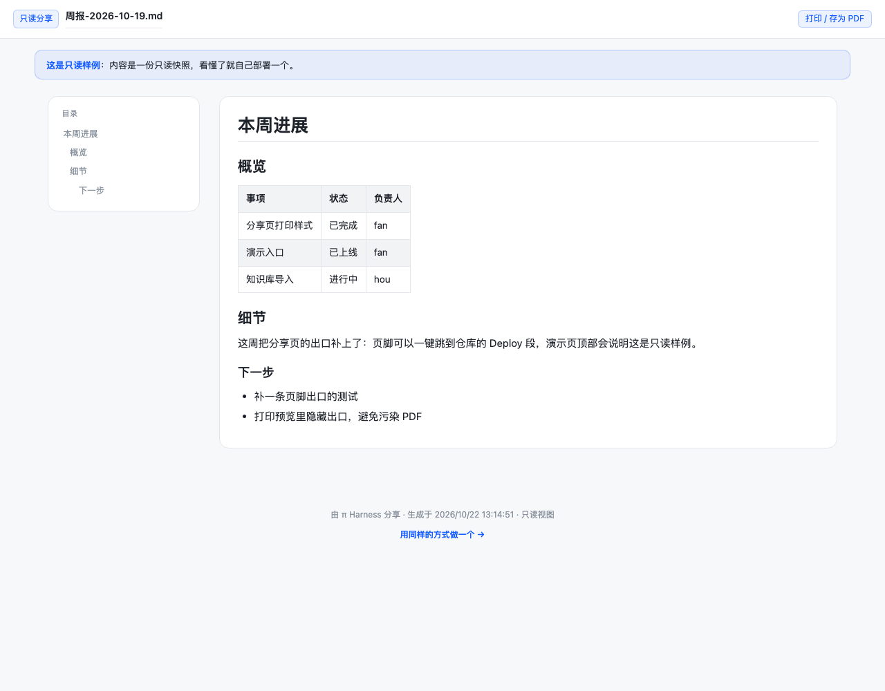

<div align="center">


# Cloudflare Free Web Pi

### Your own multi-user AI workspace, on Cloudflare's free tier.

**Durable agent runtime · per-user spaces · Chinese-first knowledge base · files shared from your own domain.**<br>
One Worker and Durable Objects. No server, no external database.

[](https://github.com/scudong/cloudflare-free-web-pi/releases) [](https://github.com/scudong/cloudflare-free-web-pi/stargazers) [](LICENSE) [](https://github.com/scudong/cloudflare-free-web-pi/actions/workflows/deploy.yml)<br>
   

**English** · [简体中文](README.zh-CN.md) · [Quick start](#5-minute-quick-start) · [Features](#what-you-get) · [How it works](#how-it-works) · [Deploy](#deploy)

[](https://deploy.workers.cloudflare.com/?url=https://github.com/scudong/cloudflare-free-web-pi)


<sub>Author's instance: **[pi-harness-gw.pages.dev](https://pi-harness-gw.pages.dev)** — invite code required; deploy your own for daily use.</sub>

</div>

## Three things it does

<p align="center">
  
  
  
</p>
<p align="center"><sub><b>Skill Hub</b> — audit before install · <b>Knowledge base</b> — per-user FTS5 search · <b>Share page</b> — read-only, on your own domain</sub></p>

## Why this exists

Most AI chat apps are rented, not owned:

- Close the tab and the context is gone.
- The report lives in a chat log, not a file you can send.
- Sharing means copy-paste, screenshots, or a link on someone else's domain.
- A team sharing one account has one shared history.
- Self-hosting usually means a VPS, Postgres, Redis, and a weekend.

Cloudflare Free Web Pi is the opposite: a workspace you deploy to your own Cloudflare account, with a durable agent, isolated spaces, a knowledge base, and files you share from your own domain.

## What you get

- **A durable agent, not a chat shell.** Work is persisted before it runs. Restart the Durable Object and it continues. Cron automations and goal mode keep going with the browser closed.
- **Per-user spaces.** Invite codes; each user gets their own Durable Object — sessions, files, memory, knowledge base, and share tokens are isolated. The owner issues, resets, and revokes codes from the UI. Revoking is immediate: the old token stops working and every share link that user created returns 404, while their data is retained by default; a separate, explicitly confirmed purge removes it (export first, irreversible after).
- **Files with a share button — on your own domain.** The agent writes Markdown and HTML into a workbench. One click produces a public page served from your Cloudflare domain (the default `*.pages.dev` subdomain, or a custom domain you bind) with an expiry (1 hour to forever), four themes, a table of contents, and a print / PDF button. The left-rail share panel shows open counts and lets you revoke a link; the model can call `share_file` / `share_conversation` itself.
- **A knowledge base that answers first.** Per-user FTS5 index with Chinese bigram tokenization and bm25. The top 3 chunks are injected before every turn; the model can also call `kb_search` itself. Import PDF, DOCX, Markdown, text, or a URL; the same source with the same body is deduplicated, and a changed body replaces the old document in place. Switch to Vectorize + bge-m3, or hybrid retrieval (RRF), in Settings.
- **A Skill Hub with an audit gate.** The catalog ships 12 prompt skills (6 built in, 6 external). Browse, filter, inspect the audit report, and install — but only after a deterministic audit: prompt / JavaScript / TypeScript pass; Python, shell, binaries, host APIs and undeclared network use are blocked before they reach the database. Installed skills show runtime, audit verdict, and last use, with a one-click trial that only fills the composer.
- **Real tools.** 26 built-in tools in the default install: web search, MCP servers, skills, share links, prompts, rules, custom JS tools, parallel subagents, and a QuickJS codemode sandbox.
- **Control and visibility.** Read/write/exec tool approvals with per-tool overrides, thinking levels, a context meter, manual compaction, step plans, and structured `ask_user` cards.
- **Chinese-first, four themes.** The UI, prompts, and docs are written in Chinese; light, dark, sepia, and midnight themes; pages.dev proxy for access from mainland China.

## How it differs

- **No always-on server.** Nothing to keep alive but a Worker and one Durable Object per user. There is no VPS, container, Postgres, Redis, or object store to patch, size, or pay for. The evidence is the deployment: `wrangler.jsonc` declares one Worker and two Durable Object classes, and `GET /api/backup` exports all user data.
- **Durable Object SQLite is the database.** Sessions, files, memory, knowledge base, approvals, automations, and share tokens live in the per-user DO's SQLite through versioned migrations (`src/worker/db/migrations.ts`, currently v8). Tasks are persisted before they run, so a restarted object resumes instead of losing the turn.
- **Skills pass an audit before install.** `POST /api/skills/import` runs `src/worker/lib/skill-audit.ts` first; a blocked skill returns HTTP 422 and is never written. `npm run catalog:check` is a CI gate that keeps the 12-skill catalog free of blocked entries and verifies every `sha256` against the skill body.
- **The share link is the output.** A finished report is a file in the workbench, not a chat log. One click — or the `share_file` tool — turns it into a read-only page at `/s/<token>` on your own domain, with an expiry and a theme; `DELETE /api/shares/<token>` revokes it immediately.

## 5-minute quick start

Requirements: Node.js 22, a Cloudflare account (the free plan is enough), and a DeepSeek API key.

### Run locally (about 3 minutes)

```bash
git clone https://github.com/scudong/cloudflare-free-web-pi.git
cd cloudflare-free-web-pi
npm install
npm run build:web

# Local secrets: only the variable names are shown here. Fill in your values after the =.
printf 'DEEPSEEK_API_KEY=\nACCESS_PASSWORD=\n' > .dev.vars

npx wrangler dev     # Worker + Durable Objects: http://localhost:8787
```

Open `http://localhost:8787` and enter your `ACCESS_PASSWORD` value. Confirm the Worker is up:

```bash
curl http://localhost:8787/api/auth
# {"required":true,"authenticated":false,"owner":false,"demoUrl":"/s/jrbxvkz8em3u"}
```

If `ACCESS_PASSWORD` is empty the site runs open to anyone; set a value before exposing it. For UI work, `npm run dev:web` runs Vite with hot reload on `http://localhost:5173` and proxies `/api` to 8787. `wrangler dev` serves the built `dist-web/`, so re-run `npm run build:web` after frontend changes.

**Local limits**: `wrangler dev` has no working `AI` or `Vectorize` binding, so vector and hybrid knowledge-base retrieval are empty locally. The default FTS5 keyword search works. Verify vector retrieval on a deployed instance.

### Deploy to your account (about 2 minutes)

One-click: the **Deploy to Cloudflare** button above forks the repository into your GitHub account, builds it with Workers Builds, and deploys it to your Cloudflare account. Set the build command to `npm run build:web`. After the first deploy, add `DEEPSEEK_API_KEY` and `ACCESS_PASSWORD` under Worker → Settings → Variables and Secrets, then redeploy.

Or from the CLI:

```bash
npx wrangler login
npx wrangler vectorize create pi-kb --dimensions=1024 --metric=cosine   # once per account
npm run build:web
npx wrangler deploy                  # first deploy creates the Worker and both Durable Objects

npx wrangler secret put DEEPSEEK_API_KEY
npx wrangler secret put ACCESS_PASSWORD
```

Open the `*.workers.dev` URL printed by `wrangler deploy` and sign in with the `ACCESS_PASSWORD` value. `wrangler secret put` uploads a new version immediately, so no separate redeploy is needed.

Run the full suite with `npm test` — unit, API, and multi-user isolation cases, including real `wrangler dev` instances (about 30 seconds). The deploy badge above is the source of truth for pass/fail; this README does not track a test count.

## How it works

<p align="center">
  
</p>

- **One Worker** serves the React app and the API (`/api/*`, share pages at `/s/<token>`).
- **One Durable Object per user** holds sessions, files, memory, knowledge base, and share tokens in SQLite. No external database.
- **pi-durable** runs the agent loop and persists tasks; **QuickJS** runs codemode; **MCP** adds external tools; **DeepSeek** is the default model, and any OpenAI-compatible endpoint can be configured.

## Deploy

### One-click

The **Deploy to Cloudflare** button above (or [this link](https://deploy.workers.cloudflare.com/?url=https://github.com/scudong/cloudflare-free-web-pi)) copies the repository into your GitHub account, builds it with Workers Builds, and deploys it to your Cloudflare account.

- **Build command**: set it to `npm run build:web`. The repo has no `build` script, so leaving this blank deploys without `dist-web/` and fails.
- **Deploy command**: keep the default `npx wrangler deploy`.
- After the first deploy, add `DEEPSEEK_API_KEY` and `ACCESS_PASSWORD` under Worker → Settings → Variables and Secrets, then redeploy. **Without `ACCESS_PASSWORD` the site runs open to anyone.**
- Create the Vectorize index before the first build: `npx wrangler vectorize create pi-kb --dimensions=1024 --metric=cosine`. Durable Objects and Workers AI are provisioned from `wrangler.jsonc`; a Vectorize binding needs the named index to exist.

### From the command line

```bash
npm install
npm run build:web
npx wrangler login
npx wrangler vectorize create pi-kb --dimensions=1024 --metric=cosine
npx wrangler deploy
npx wrangler secret put DEEPSEEK_API_KEY
npx wrangler secret put ACCESS_PASSWORD
```

Or push to `main` and let GitHub Actions deploy. Add `CLOUDFLARE_API_TOKEN`, `CLOUDFLARE_ACCOUNT_ID`, and `SMOKE_PASSWORD` to the repository secrets; CI runs the test suite, deploys, and smoke-tests the live Worker.

## Is it for you?

**Yes** if you want an AI workspace you own, reports you can share as links, or isolated spaces for a small team — without running a server.

**No** if you want a zero-setup SaaS, need vector/semantic search over millions of documents, or want a coding IDE rather than a general workspace.

## Docs

- [简体中文 README](README.zh-CN.md) — full feature table, architecture notes, HTTP API, and operational caveats
- [v1.0.0 release notes](docs/release-notes-v1.0.0.md) — what shipped, with demo links
- [Knowledge base design](docs/knowledge-base.md) — why FTS5, how chunking and prefetch work, limits
- [Changelog](CHANGELOG.md) — every release; v1.0.0 entries carry PR numbers

## License

[MIT](LICENSE). Not affiliated with Cloudflare, Inc. Cloudflare, Workers, and Durable Objects are trademarks of Cloudflare, Inc.
