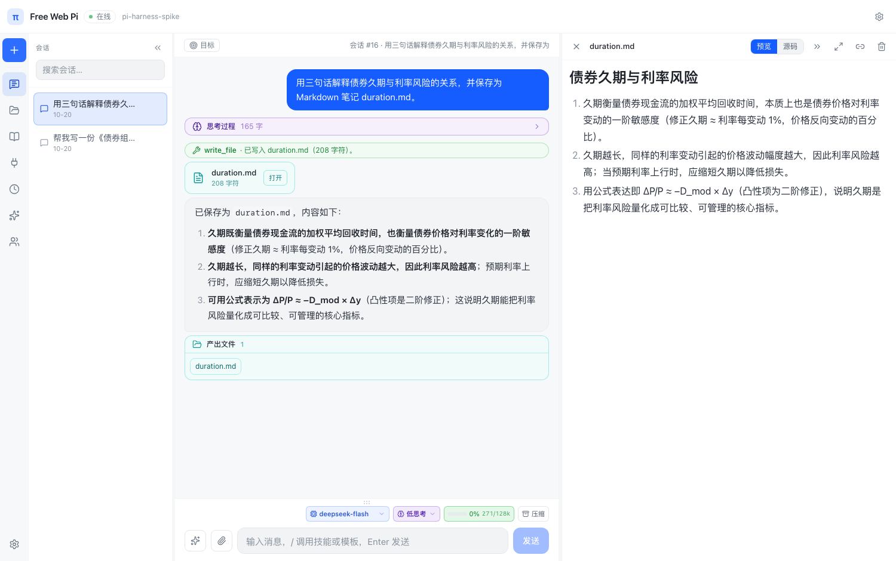

# π Harness — Cloudflare 上的中文 AI 助手

把 [pi](https://github.com/earendil-works/pi) 的 **durable harness 内核**跑在 Cloudflare Worker 上：会话、工具调用、记忆、文件全部持久化在 Durable Object 的 SQLite 里，不依赖任何外部数据库。

- **在线地址**：https://pi-harness-gw.pages.dev （pages.dev 反代，中国大陆可达）
- **运行成本**：Cloudflare 免费额度内；模型走 DeepSeek（按量计费，个人用量每月几元）



---

## 功能

| 模块 | 能力 |
|---|---|
| 会话 | 多会话隔离、自动标题、重命名、删除、**按会话选择模型**（`deepseek-flash` / `deepseek-v4-pro`） |
| 对话 | SSE 流式逐字输出、**可折叠思考过程**、**吸顶计划清单**（`update_plan`）、工具调用实时 pill（含 codemode 内嵌调用）、**产出文件卡**、完整 Markdown（表格/任务列表/代码复制）、图片输入（粘贴或上传，自动压缩 ≤1568px） |
| 执行 | `codemode`：模型写 JavaScript 在 QuickJS 沙箱里跑，脚本内可 `await tools.<name>()` 调用其它工具；`dispatch_tasks`：2–4 个独立子任务并行分派给子代理后汇总 |
| 网页 | `web_search` 联网搜索 + `web_fetch_page` 抓取正文（DeepSeek 搜索 API，设置中可开关）；`http_fetch` 直接抓取；**Browserbase MCP** 云端浏览器（导航/点击/提取，无需本地 Chrome） |
| 记忆 | `remember` / `recall` + 每 6 条自动 `reflect` 抽取长期事实（带去重） |
| 文件 | 按会话隔离的虚拟文件系统（`write_file` / `read_file` / `list_files`），右栏可预览 Markdown 与 HTML；**Markdown / HTML 可生成带有效期的公开分享链接** |
| 能力 | **能力注册表**（内置/数据/协议三类汇总）、**提示模板**（`/` 展开，支持 `$1` 占位）、**规则文件**（每轮注入）、自定义技能（`SKILL.md` 规范）+ 一键安装 `badlogic/pi-skills` 社区技能；模型按需 `load_skill`，也可在输入框用 `/技能名` 显式调用 |
| 扩展 | 任意 **MCP** 服务器（Streamable HTTP，支持自定义请求头） |
| 定时 | Durable Object alarm 驱动的定时任务（每天 HH:MM / 每隔 N 分钟） |
| 其他 | **左侧工具栏**（新会话/会话/连接/定时/技能/用户/设置）、**设置页**（分 tab：通用/对话/模型/记忆/数据）、**模型供应商管理**（任意 OpenAI 兼容端点，CCswitch 式切换）、一键清空记忆、只读分享链接（会话 / Markdown / HTML，可设有效期）、Markdown 导出、全量备份/恢复、四套主题（深色/浅色/米黄/午夜蓝，Arco 字节色卡）、访问密码 + 邀请码多用户（独立空间） |

---

## 架构

```
浏览器
  │  https://pi-harness-gw.pages.dev      ← pages.dev 反代（大陆可达）
  ▼
Cloudflare Worker（静态前端 + API 入口）
  ├── 静态资源：dist-web（React + Vite + Tailwind）
  └── /api/*、/s/* → Durable Object
                     ├── pi-durable Harness（会话 / 任务 / 工具调度）
                     ├── Storage = openDurableObjectSqliteStorage（DO SQLite）
                     ├── 模型：pi-ai deepseekProvider
                     ├── codemode：QuickJS WASM 沙箱
                     └── MCP 客户端（Streamable HTTP）
```

**关键设计**

- **持久化**：`@earendil-works/pi-durable` 的 `Storage` 接口 + 官方 DO SQLite 适配器，会话/任务提交前落盘，进程重启自动续跑
- **工具循环**：pi-durable 的 `generation` 任务原生支持多步工具调用与 `tool_search` 渐进披露
- **扩展注入**：扩展必须在 `Harness.open` 之前 `registry.install`，否则已存在会话解析不到
- **自愈**：存储类错误触发 `close + reopen`；定时任务遇到会话忙会顺延，避免并发写坏会话

---

## 快速开始

```bash
npm install
npm test                     # 金标回归（单元 + 接口），约 3 秒

# 本地开发（.dev.vars 里放密钥）
echo "DEEPSEEK_API_KEY=sk-..." >> .dev.vars
echo "ACCESS_PASSWORD=你的访问密码" >> .dev.vars

npm run dev:web              # 前端热更新：http://localhost:5173
npx wrangler dev             # Worker + DO：http://localhost:8787
```

生产部署：

```bash
npx wrangler secret put DEEPSEEK_API_KEY
npx wrangler secret put ACCESS_PASSWORD
npx wrangler secret put BUILD            # 可选：构建号，用于判断线上是否更新
npx wrangler deploy
```

推送 `main` 会自动部署（`.github/workflows/deploy.yml`），需要仓库 secrets：`CLOUDFLARE_API_TOKEN`、`CLOUDFLARE_ACCOUNT_ID`。

---

## HTTP API

除 `/api/auth`、`/api/login`、`/s/*` 外，均需登录 cookie。

| 方法 | 路径 | 说明 |
|---|---|---|
| GET | `/api/auth` | 是否需要登录 / 当前是否已登录 |
| POST | `/api/login` | `{password}` → 下发签名 cookie |
| GET | `/api/sessions` | 会话列表 |
| POST | `/api/sessions` | 新建会话 |
| PATCH / DELETE | `/api/sessions` | 重命名 / 删除（同时清空该会话文件） |
| POST | `/api/chat` | `{message, sessionId?, images?}` → `{answer, tools}` |
| POST | `/api/chat/stream` | 同上，SSE：`text` / `tool_start` / `tool_end` / `done` |
| GET | `/api/entries?sessionId=` | 会话转录 |
| GET | `/api/files?sessionId=` | 工作台文件列表 |
| GET | `/api/files/content?sessionId=&name=` | 文件内容 |
| GET / POST / DELETE | `/api/skills` | 技能增删查 |
| GET | `/api/skills/community` | 社区技能目录（badlogic/pi-skills） |
| POST | `/api/skills/import` | `{url}` 从 GitHub/raw/任意 md 导入技能 |
| GET / POST / DELETE | `/api/mcp` | MCP 服务器配置（支持 `headers`） |
| GET / POST / DELETE | `/api/providers` · `/api/providers/activate` | LLM 供应商（自定义 OpenAI 兼容端点） |
| GET / POST | `/api/settings` | 全局设置（网页搜索开关 `webSearch`、思考档位 `thinkingLevel`） |
| GET | `/api/plan?sessionId=` | 当前会话的分步计划 |
| GET | `/api/context?sessionId=` | 上下文占用估算（百分比 / 窗口） |
| GET / POST / PATCH / DELETE | `/api/automations` | 定时任务 |
| POST | `/api/share` · GET `/s/<token>` | 只读分享（`kind=conversation/file`，`ttlSeconds` 可选，0 = 永久；`theme` 记录分享页配色） |
| GET | `/api/shares?sessionId=&kind=&name=` | 未过期的分享链接（打开弹窗时复用） |
| GET | `/api/export?format=md` | 导出 Markdown |
| GET / POST | `/api/backup` · `/api/restore` | 全量备份 / 合并恢复 |
| GET | `/api/version` | 线上构建号（CI 注入 git SHA） |
| GET / POST / DELETE | `/api/users` · `POST /api/users/reset` | 邀请用户管理（仅主人；码只返回一次） |

---

## 内置工具

`now` · `remember` · `recall` · `update_plan` · `dispatch_tasks` · `list_skills` · `load_skill` · `web_search` · `web_fetch_page` · `http_fetch` · `write_file` · `read_file` · `list_files` · `codemode` · `tool_search`，以及所有已配置 MCP 服务器的工具（`mcp__<服务器>__<工具>`）。

---

## 注意事项

- **Durable Object 换代码有延迟**：部署后旧实例可能继续运行旧代码 **5–10 分钟**，且持续请求会让它不驱逐。判断线上是否真的更新，看 `GET /api/version` 返回的 git SHA，不要凭「功能没生效」下结论。
- **访问密码与邀请码**：`ACCESS_PASSWORD` 是主人密码；左栏「用户」可生成邀请码，邀请码登录后进入独立空间（自己的会话 / 文件 / 记忆）。删除用户后其登录态立即失效；改密码会让所有设备立即退出（邀请码仍可重新登录）。
- **数据隔离**：主人沿用历史数据所在的 Durable Object；每个邀请用户使用独立的 `user:<id>` Durable Object，互不可见。
- **密钥落库**：MCP 的请求头（如 `x-bb-api-key`）存在 DO 数据库里，**会随 `/api/backup` 导出**，分享备份时注意。
- **免费额度**：Workers / DO / QuickJS 均在免费额度内；DeepSeek 与 Browserbase 按量计费。

---

## 目录结构

```
src/
  worker.ts              # Worker 入口 + Durable Object（API、工具、存储、调度）
  web/                   # React 前端
    components/          #   Rail / Sidebar / LeftPanels / ChatHeader / MessageList / Composer / Workbench / TopBar / SettingsDialog
    lib/                 #   api 客户端、SSE 解析、Markdown 渲染、宽容解析器
wrangler.jsonc           # Worker + DO + 静态资源绑定
.github/workflows/deploy.yml
tests/                   # 金标用例（unit 纯函数 / api 接口），见 tests/README.md
CHANGELOG.md             # 逐版本更新记录
```

---

## 版本

完整记录见 [CHANGELOG.md](./CHANGELOG.md)。里程碑：

`v0.10` 访问密码 · `v0.11` 主题 · `v0.12` 图片输入 · `v0.13` 工具搜索 · `v0.14` 备份恢复 · `v0.15` 技能/预览 · `v0.16` 右栏可伸缩 · `v0.17` 社区技能 · `v0.18` Browserbase 云端浏览器 · `v0.19` 服务端停止 · `v0.20` 设置页/联网搜索 · `v0.21` 左栏工具栏 · `v0.22` 思考/计划/轨迹 · `v0.23` 输入框调用技能 · `v0.24` 四套主题 · `v0.25` Arco 色卡 · `v0.26` 设置分 tab · `v0.27` 模型供应商 · `v0.28` 金标回归 · `v0.29` 子代理编排 · `v0.30` 能力注册表

## 致谢

- [earendil-works/pi](https://github.com/earendil-works/pi) — durable agent harness、pi-ai、pi-codemode、pi-mcp
- [badlogic/pi-skills](https://github.com/badlogic/pi-skills) — 社区技能目录
